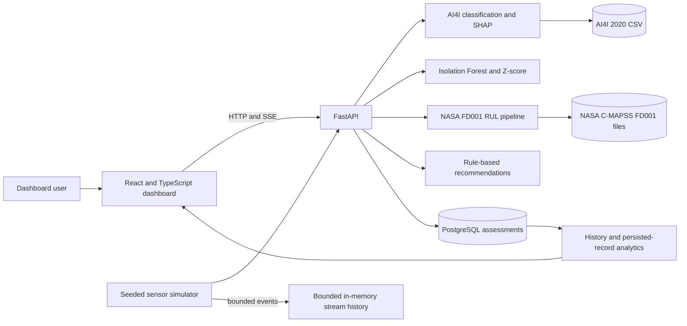

# IntelliMaint AI

**Intelligent Predictive Maintenance and Remaining Useful Life Estimation Using Machine Learning and Explainable AI**

IntelliMaint AI is an academic research prototype built with a React/TypeScript frontend and a Python/FastAPI backend. It evaluates machine-failure classification and anomaly indicators using the AI4I 2020 benchmark dataset, and estimates remaining useful life (RUL) using the separate NASA C-MAPSS FD001 dataset. It also demonstrates explicitly persisted assessment history, database-derived analytics, deterministic recommendations, and clearly labelled simulated sensor readings.

> **Scope:** This project is not connected to physical equipment. Simulation readings are synthetic, benchmark results are not industrial validation, and the application must not be used to control equipment or make real maintenance decisions.

## Problem statement

Machine condition data can be difficult to interpret without tools that distinguish a model prediction from an unusual reading, explain an individual score, estimate remaining life, and retain assessment history. IntelliMaint AI demonstrates those software workflows using public benchmark data. It keeps the AI4I failure-classification pipeline separate from the NASA FD001 RUL pipeline and clearly labels simulated data and persisted records.

## Objectives

- Compare four classifiers on AI4I using a consistent, seeded train/test split and training-only cross-validation.
- Provide local SHAP explanations and separate Isolation Forest and Z-score anomaly indicators.
- Estimate RUL for NASA C-MAPSS FD001 using engine-wise validation and regression metrics.
- Demonstrate synthetic monitoring without representing generated readings as real telemetry or persisting automatic simulation assessments.
- Persist explicit assessments, expose filtered history, and calculate analytics from persisted records.
- Provide deterministic, explainable recommendation reasons and actions.

## Implemented functionality

- **AI4I classification:** Logistic Regression, Random Forest, Decision Tree, and XGBoost.
- **Model evaluation:** stratified 80/20 holdout, three-fold stratified cross-validation on training data only, and accuracy, precision, recall, F1, ROC-AUC, and confusion matrices.
- **Explainability:** per-reading SHAP contributions for the selected classifier, with training-only background data and an additivity check.
- **Anomaly detection:** Isolation Forest plus a separate statistical Z-score detector.
- **NASA RUL:** Linear Regression, Random Forest Regressor, and XGBoost Regressor in a distinct FD001 pipeline.
- **Assessment and recommendations:** failure prediction, anomaly results, severity, reasons, and rule-based actions.
- **Simulated monitoring:** normal, abnormal, and mixed synthetic modes; bounded in-memory event history; automatic assessments use `persist=False`.
- **PostgreSQL persistence:** explicit assessment records with timestamps, asset identifiers, source, simulation status, readings, and available assessment outputs.
- **Historical analytics:** database-backed KPIs, distributions, activity, asset comparisons, filtering, and paginated history.
- **Dashboard:** overview, prediction, evaluation, anomaly, RUL, simulation, and history views.

## Technology stack

| Area | Technologies |
|---|---|
| Backend | Python, FastAPI, Uvicorn, Pydantic |
| Classification and regression | scikit-learn, XGBoost |
| Explanations | SHAP |
| Data handling | pandas, NumPy |
| Persistence | SQLAlchemy, PostgreSQL, psycopg |
| Frontend | React, TypeScript, Vite |
| Testing | pytest, HTTPX; frontend TypeScript/Vite production build |

Dependency ranges are declared in [`requirements.txt`](requirements.txt) and [`frontend/package.json`](frontend/package.json). The environment used for the recorded benchmark work was Python 3.12.10, scikit-learn 1.9.1, and XGBoost 3.4.1. The frontend build environment observed during project work was Node.js v26.13.1 and npm 11.20.0. These observed versions are not a cross-version compatibility certification.

## System architecture



The backend lazily initializes the AI4I and RUL model systems. After training, each system is cached under `backend/.model_cache`; the cache is reused only when its source, dataset, Python, and relevant ML package fingerprints match. A cache miss or stale cache triggers normal training, without changing the algorithms or evaluation. Delete that directory to force retraining. Database access initializes the configured SQLAlchemy connection and table when available. The development Vite server proxies `/api` requests to `http://127.0.0.1:8000` by default. The simulator is not a hardware adapter; its generated records are labelled as simulated.

## Project structure

```text
IntelliMaint-AI/
├── backend/
│   ├── app/
│   │   ├── database.py          # SQLAlchemy model, persistence, history, analytics
│   │   ├── main.py              # FastAPI routes
│   │   ├── ml.py                # AI4I classifiers, SHAP, IF and Z-score
│   │   ├── monitoring.py        # Assessment composition and stream hub
│   │   ├── recommendations.py   # Deterministic rule-based recommendations
│   │   ├── rul.py               # NASA FD001 regression pipeline
│   │   ├── runtime.py           # Cached lazy model initialization
│   │   ├── schemas.py           # API request validation
│   │   └── simulator.py         # Synthetic AI4I-shaped readings
│   ├── data/
│   │   ├── ai4i2020.csv
│   │   └── nasa/
│   │       ├── train_FD001.txt
│   │       ├── test_FD001.txt
│   │       └── RUL_FD001.txt
│   └── tests/
│       ├── test_database.py
│       ├── test_main.py
│       ├── test_ml.py
│       ├── test_recommendations.py
│       ├── test_rul.py
│       └── test_simulation.py
├── frontend/
│   ├── src/
│   │   ├── App.tsx
│   │   ├── App.css
│   │   ├── index.css
│   │   └── main.tsx
│   ├── index.html
│   ├── .oxlintrc.json
│   ├── package.json
│   ├── package-lock.json
│   ├── tsconfig.json
│   ├── tsconfig.app.json
│   ├── tsconfig.node.json
│   └── vite.config.ts
├── requirements.txt
├── .gitignore
├── run.py
└── README.md
```

Generated directories such as `venv`, `node_modules`, `dist`, bytecode caches, and local test databases are omitted.

## AI4I failure prediction

The AI4I workflow uses the product type and five numeric sensor fields: air temperature, process temperature, rotational speed, torque, and tool wear. Unique identifiers, failure-mode labels, and the target are excluded from model inputs. Numeric scaling and categorical encoding are fitted inside each model pipeline using training data only.

The split is stratified, with 80% training and 20% holdout data, using `random_state=42`. Candidate classifiers are evaluated using three-fold `StratifiedKFold` cross-validation on the training portion only. The final classifier is selected by mean cross-validation F1. All four models are then evaluated against the same untouched holdout set.

### Measured holdout results

These are the recorded benchmark measurements for the included AI4I dataset and seeded split; they have not been recalculated for this documentation update.

| Model | Accuracy | Precision | Recall | F1 | ROC-AUC |
|---|---:|---:|---:|---:|---:|
| Logistic Regression | 82.5% | 14.2% | 82.4% | 24.2% | 90.7% |
| Random Forest | 98.2% | 80.4% | 60.3% | 68.9% | 95.7% |
| Decision Tree | 97.9% | 73.2% | 60.3% | 66.1% | 79.8% |
| XGBoost | 98.6% | 91.5% | 63.2% | 74.8% | 97.7% |

The class-1 `predict_proba` score is **uncalibrated** and must not be interpreted as a real-world failure probability. Results depend on this fixed split and benchmark dataset; they do not establish performance on physical equipment.

## NASA C-MAPSS FD001 RUL

NASA FD001 is a separate regression pipeline; its three operating settings and 21 sensor measurements are not AI4I inputs. The included files contain 100 training engines and 100 test engines, with 20,631 training observations and 13,096 test observations.

- Training target: `min(125, engine maximum cycle - current cycle)`.
- Validation: five-fold `GroupKFold` grouped by engine ID. Each held-out validation engine uses one reproducible seeded snapshot strictly before its final training cycle; future cycles are excluded.
- Selection: lowest training-only validation RMSE among Linear Regression, Random Forest Regressor, and XGBoost Regressor.
- Final test: official `RUL_FD001.txt` labels remain uncapped. Evaluation uses the last observed row for each of the 100 test engines.
- Metrics: MAE, RMSE, and the NASA asymmetric score. For `d = predicted RUL - actual RUL`, the score sums `exp(-d/13) - 1` for negative `d` and `exp(d/10) - 1` for non-negative `d`; overestimation is penalized more heavily.

| Model | Validation RMSE | Validation MAE | Validation NASA | Test RMSE | Test MAE | Test NASA |
|---|---:|---:|---:|---:|---:|---:|
| Linear Regression | 22.964 | 18.014 | 1326.988 | 21.678 | 17.435 | 1292.231 |
| Random Forest | 19.881 | 14.362 | 1149.371 | 17.928 | 13.129 | 869.977 |
| XGBoost | 20.776 | 14.579 | 1473.723 | 18.661 | 13.575 | 1012.637 |

Random Forest was selected by the lowest training-only validation RMSE. These are FD001 benchmark results, not validated industrial forecasts or maintenance decisions. The project does not implement LSTM.

## Anomaly detection

### Isolation Forest

Isolation Forest is fit on transformed AI4I training sensor features with an explicit 3% contamination assumption. Its output is an outlier flag and anomaly score, not a probability or confirmed equipment failure. On the recorded AI4I holdout comparison against failure labels, it achieved 17.2% precision, 14.7% recall, and 15.9% F1. These measurements do not establish real-world anomaly-detection performance.

### Z-score

The Z-score detector uses a healthy-only baseline from the AI4I training data and evaluates the five numeric sensor features. A feature is reported as exceeded when its absolute Z-score reaches the threshold of 3. Zero-variance and invalid-value cases are handled and tested. A statistical anomaly indicates deviation from the reference baseline; it does not confirm a failure.

## Simulated sensor monitoring

`SensorSimulator` generates seeded random-walk readings shaped like AI4I inputs. It supports `normal`, `abnormal`, and `mixed` modes; abnormal readings are generated to exercise anomaly and recommendation paths. Every generated reading is explicitly labelled simulated.

The stream hub keeps at most 100 events in memory. Periodic simulation can be started with an interval from 0.5 to 30 seconds. Automatic simulation assessments call the assessment function with `persist=False`, so generating or polling simulation events does **not** create PostgreSQL assessment records. The simulation must not be described as real sensor telemetry or hardware monitoring.

## Rule-based maintenance recommendations

Recommendations are deterministic rules, not LLM output. AI4I assessment recommendations combine published AI4I failure-mode conditions, classifier priority/prediction, Isolation Forest, and Z-score indicators. The result contains a severity (`routine`, `warning`, `urgent`, or `critical`), reasons, actions, and a benchmark disclaimer. Higher-risk combinations receive higher severity according to the implemented rule precedence.

RUL recommendations use separate demo bands: below 20 cycles is `critical`, 20 to less than 50 cycles is `watch`, and 50 cycles or more is `routine`. Recommendation labels are informational annotations: they do not confirm equipment failure, create work orders, or constitute maintenance instructions.

## PostgreSQL persistence and schema

SQLAlchemy stores persisted records in one `assessments` table. The record includes:

| Column | Stored information |
|---|---|
| `id` | Primary key |
| `created_at` | Assessment timestamp |
| `source` | Origin such as manual or ingest |
| `asset_id` | Asset/machine identifier |
| `kind` | Assessment type |
| `reading` | JSON input fields |
| `prediction`, `anomaly`, `zscore` | Available AI4I results as JSON |
| `recommendation`, `rul` | Available recommendation/RUL results as JSON |
| `simulated` | Whether the persisted reading is labelled simulated |

Indexes support timestamp, asset/timestamp, and kind/timestamp queries. Database initialization creates the table when a connection is available. `DATABASE_URL` can override the database URL. Set it in the local environment rather than committing a connection string; never place passwords or credentials in API examples, logs, or version control. The repository has a development fallback, so configure an environment-specific URL explicitly before sharing or deploying the project. Database credentials are not documented here.

Individual prediction/anomaly endpoints attempt to record their respective result when persistence is available. `/api/assess`, `/api/stream/ingest`, and `/api/rul/predict` use assessment workflows that may persist records. Automatic simulation generation does not persist. When PostgreSQL is unavailable, history and analytics return a visible unavailable state; analytics does not substitute invented data.

## Historical analytics dashboard

The React dashboard displays persisted-record KPIs for assessment totals, predicted failures, normal assessments, anomaly assessments, urgent/critical recommendations, and monitored assets. Charts show activity by day, failure distribution, anomaly distribution, severity distribution, and assessments by asset. The API calculates analytics over **all matching persisted records**, not only the current history page. Optional asset and inclusive ISO-8601 date filters are supported.

The history table uses pagination and supports asset, assessment-kind, and date-range filters. A persisted simulated assessment remains identifiable through its `simulated` flag. Unpersisted simulation events do not contribute to analytics. An empty database produces zero counts and empty chart series; a database connection failure is represented separately.

## API reference

All routes are prefixed with `/api`. Interactive OpenAPI documentation is available at `/docs` when the backend is running. Request bodies vary by endpoint; there is no single body shared by all POST routes.

| Method and route | Inputs | Purpose / behavior |
|---|---|---|
| `GET /api/health` | — | Dataset availability and database connection status. |
| `GET /api/overview` | — | Dataset summary, selected model, CV F1, classification metrics, anomaly metrics, and feature importance. |
| `POST /api/predict` | AI4I sensor body | Selected classifier prediction and priority; attempts to record the prediction. |
| `POST /api/explain` | AI4I sensor body | Selected model's uncalibrated score and per-input SHAP contributions. |
| `POST /api/anomaly` | AI4I sensor body | Isolation Forest flag, score, and contamination assumption; attempts to record the anomaly check. |
| `POST /api/zscore` | AI4I sensor body | Z-scores, exceeded features, anomaly flag, and threshold. |
| `POST /api/assess` | AI4I sensor fields plus optional `asset_id` | Combined prediction, anomalies, recommendation, and persistence result. |
| `POST /api/stream/ingest` | AI4I sensor fields plus optional `asset_id` | Assesses an ingested reading and publishes an event. |
| `GET /api/history` | `limit` (1–200, default 50), optional `kind` | Recent persisted records. |
| `GET /api/assessments` | `limit` (1–200, default 50), `offset` (default 0), optional `asset_id`, `kind`, `start`, `end` | Paginated history; `start`/`end` are ISO-8601 datetimes and inclusive. |
| `GET /api/assessments/{assessment_id}` | Integer path ID | Retrieve one persisted assessment; 404 if absent and 503 if the database is unavailable. |
| `GET /api/analytics` | Optional `asset_id`, `start`, `end` | Aggregates over all matching persisted rows; filters use inclusive ISO-8601 bounds. |
| `GET /api/stream/status` | — | Stream state, interval, in-memory publication count, and latest event. |
| `POST /api/stream/start` | Optional JSON `{"interval_seconds": 2.0}`; 0.5–30 | Start periodic simulated streaming. |
| `POST /api/stream/stop` | — | Stop the background stream. |
| `GET /api/stream/events` | — | Server-Sent Events stream. |
| `POST /api/simulation/generate` | Query `mode=normal\|abnormal\|mixed` (default `mixed`) | Generate one labelled synthetic reading and assessment; not persisted automatically. |
| `GET /api/simulation/latest` | — | Latest simulated event, or `available: false`. |
| `GET /api/simulation/history` | `limit` (1–100, default 50) | Bounded in-memory simulated event history. |
| `POST /api/simulation/reset` | Query `seed` (0–2147483647, default 42) | Reset simulator and in-memory history. |
| `GET /api/rul/overview` | — | FD001 dataset summary, validation/test metrics, selected model, and methodology. |
| `POST /api/rul/predict` | RUL body | Estimate RUL from three operational settings and 21 sensor fields; uses the RUL assessment workflow. |

**AI4I request fields:** `product_type` (`L`, `M`, or `H`), `air_temperature`, `process_temperature`, `rotational_speed`, `torque`, and `tool_wear`. Assessment and ingest requests also accept `asset_id` (default `manual-entry`).

**RUL request fields:** `operational_setting_1`, `operational_setting_2`, `operational_setting_3`, and `sensor_1` through `sensor_21`. RUL values are NASA FD001 inputs; they are not AI4I sensor fields.

Example AI4I prediction request:

```json
{
  "product_type": "M",
  "air_temperature": 300.0,
  "process_temperature": 310.0,
  "rotational_speed": 1500,
  "torque": 40.0,
  "tool_wear": 100
}
```

## Installation and configuration (Windows)

### Prerequisites

- Windows 10/11.
- Python 3.12.
- Node.js and npm.
- PostgreSQL for persistent history and analytics. Model prediction can operate independently of persisted history when the database is unavailable.
- Included AI4I and NASA FD001 data files listed in the project structure above.

### Create the Python environment and install dependencies

Run from the project root in PowerShell:

```powershell
py -3.12 -m venv venv
.\venv\Scripts\python.exe -m pip install -r requirements.txt
```

Install frontend dependencies:

```powershell
Set-Location frontend
npm install
Set-Location ..
```

### Configure PostgreSQL

Create/configure a PostgreSQL database and user using your local PostgreSQL administration process. Set the SQLAlchemy URL in the PowerShell session before starting the backend:

```powershell
$env:DATABASE_URL = "postgresql+psycopg://<user>:<password>@<host>:5432/<database>"
```

Replace every placeholder locally. Do not commit this value or paste it into issue reports. The application creates the assessment table when the configured database is reachable. If no database is available, database-dependent history and analytics report that state instead of manufacturing records.

### Frontend API configuration

During Vite development, `VITE_BACKEND_URL` can override the proxy target; the default is `http://127.0.0.1:8000`. `VITE_API_BASE_URL` can set a frontend API base prefix for a built deployment; its default is the relative path. Set frontend variables before running the relevant Vite command.

## Run the application

### Development mode

Open two PowerShell terminals from the project root.

Terminal 1 — backend:

```powershell
Set-Location backend
..\venv\Scripts\python.exe -m uvicorn app.main:app --reload --host 127.0.0.1 --port 8000
```

The API is at `http://127.0.0.1:8000`; OpenAPI docs are at `http://127.0.0.1:8000/docs`.

Terminal 2 — frontend:

```powershell
Set-Location frontend
npm run dev
```

Open the local URL printed by Vite (normally `http://localhost:5173`). The Vite configuration proxies `/api` to the backend default.

### Single-command mode

After backend and frontend dependencies are installed, run from the project root:

```powershell
.\venv\Scripts\python.exe run.py
```

`run.py` first runs the frontend production build, then starts Uvicorn on `127.0.0.1:8000` and opens the local application after the backend health endpoint responds. The first run or a cache miss still trains the model systems; later starts load valid cached systems. Keep the terminal open while using the app; press `Ctrl+C` to stop it. Ensure the port is available.

## Testing and validation

Recorded project validation:

- **Focused simulation tests:** 9 passed in 6.46 seconds.
- **Complete backend suite:** 47 passed in 784.73 seconds.
- **Frontend production build:** `npm run build` passed.
- **Live API smoke test (separate from the test suite):** HTTP 200 responses were received for assessment history, analytics, RUL overview, latest simulation, normal/abnormal simulation generation, and subsequent health checks. The abnormal generated reading triggered anomaly detection, including a Torque Z-score exceedance. Persisted assessment count remained 33 before and after generation.

The complete backend suite was run using an isolated temporary copy and SQLite so existing project database state was not modified. It is **not** evidence that the suite ran against PostgreSQL. PostgreSQL API insertion/retrieval was verified separately during the persistence phase; the live simulation smoke check also confirmed automatic generated readings did not change persisted history. These are recorded checks, not a guarantee of continued availability. No application, database, or tests were run as part of this README-only update.

Commands for reproducing the project checks:

```powershell
Set-Location backend
..\venv\Scripts\python.exe -m pytest
Set-Location ..\frontend
npm run build
```

## Limitations and future improvements

- AI4I and NASA C-MAPSS FD001 are benchmark/simulation datasets; they do not validate performance on a real plant.
- No physical sensors, PLCs, industrial deployment, or live telemetry are connected.
- Classifier scores are uncalibrated; Isolation Forest and Z-score outputs are anomaly indicators, not failure probabilities or confirmed faults.
- SHAP describes the selected model's behavior, not causality or a physical root cause.
- Rule-based outputs are benchmark annotations, not work orders or maintenance instructions.
- RUL is limited to FD001 and is not an operational forecast. LSTM is not implemented.
- Automatic simulated assessments remain in bounded memory and are not persisted. Analytics covers explicit database records only.
- Local development APIs do not implement an industrial authentication/authorization layer or production deployment controls.
- Analytics currently loads all matching assessment rows before aggregating; large deployments would need query and scale evaluation.
- Add external validation, additional authorized datasets, calibration studies, access control, secret management, database migrations, retention policy, and hardware integration only after appropriate safety and privacy design.

## References

1. S. Matzka, “AI4I 2020 Predictive Maintenance Dataset,” UCI Machine Learning Repository, 2020. DOI: [10.24432/C5HS5C](https://doi.org/10.24432/C5HS5C). Licensed under [CC BY 4.0](https://creativecommons.org/licenses/by/4.0/).
2. A. Saxena and K. Goebel, “Turbofan Engine Degradation Simulation Data Set,” NASA Prognostics Data Repository, NASA Ames Research Center, 2008. [NASA C-MAPSS download](https://phm-datasets.s3.amazonaws.com/NASA/6.+Turbofan+Engine+Degradation+Simulation+Data+Set.zip).
3. F. Pedregosa et al., “Scikit-learn: Machine Learning in Python,” *Journal of Machine Learning Research*, vol. 12, pp. 2825–2830, 2011.
4. T. Chen and C. Guestrin, “XGBoost: A Scalable Tree Boosting System,” in *Proceedings of the 22nd ACM SIGKDD International Conference on Knowledge Discovery and Data Mining*, 2016, pp. 785–794, doi: 10.1145/2939672.2939785.
5. S. M. Lundberg and S.-I. Lee, “A Unified Approach to Interpreting Model Predictions,” in *Advances in Neural Information Processing Systems 30*, 2017.
